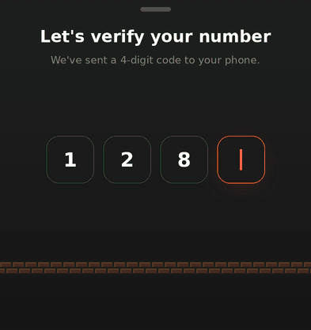

# Mario OTP

A SwiftUI one-time-code screen where verification is a tiny platformer level, styled as **Pixel × Paper**:
keycap digits on warm paper, with Mario as the pixel-art hero running along a 1-1 brick road. The key you're
typing into lifts slightly and shows a blinking pixel cursor. Type the 4-digit code and every key flips
over into a gold **?** block. Mario then punches each one from below with his signature fist-up jump:

- **Right digit**: the key bumps, turns **green** and pops a coin.
- **Wrong digit**: the key rattles and turns **red**. Mario says so in a speech bubble ("Two are off! Fix 2 and 4").
- **Some wrong**: greens stay locked in, reds clear, and you retype only those. Mario then sweeps back
  across and punches just the keys you changed.
- **All correct**: the keys collapse into a deck and become one gold ?-block. Mario punches it into a big green check
  key, and a fountain of coins bursts out. Then, like the end of a level, a brick castle rises at the end of the road,
  Princess Peach hurries out to meet him, a heart pops, and a retro dialog box types out one of her lines, like
  *"Right castle, Mario! Your code checks out. Let's-a go!"*, or a cheekier one (*"Took a few castles… …but your
  code checks out!"*) if you needed a retry. The lines are in `Flow/PrincessDialog.swift`.



*The preview is drawn from the real choreography engine's frame data (positions, timing, states). In the app,
the type is SF Pro. The design mockup is in
[`docs/concepts/pixel-paper.png`](docs/concepts/pixel-paper.png), and the other directions explored are in
[`docs/concepts`](docs/concepts).*

## Run it

You'll need **Xcode 16 or newer**. The app targets iOS 17+.

```sh
# first time
cd ~ && git clone https://github.com/nodedesignagency/mario-otp.git
cd ~/mario-otp && git checkout claude/wonderful-rubin-h46qhn && ./scripts/run.sh

# after that, to get the latest changes
cd ~/mario-otp && git fetch origin && git checkout claude/wonderful-rubin-h46qhn && git pull && ./scripts/run.sh
```

`scripts/run.sh` builds the app, boots a simulator and launches it. It uses the simulator that's already
open, or the newest iPhone Pro. Pass a name to choose: `./scripts/run.sh "iPhone 16"`.
You can also open `MarioOTP.xcodeproj` in Xcode and press **Run**.

The demo code is shown under the keys (starts as `1985`). Type it, or type something wrong first to see
the red path. The ✕ button starts over.

To run on a device, choose your team under *Signing & Capabilities*.
Sounds follow the silent switch. Use the speaker button at the top right to mute them.

## Extras beyond the reference

| | |
|---|---|
| 8-bit sound effects | Jump, coin, bonk, merge, fanfare and error sounds, synthesised at launch from square, triangle and noise waves (`ChipSounds.swift`). There are no audio files to ship. |
| Haptics | A light tap per digit, a rigid knock per key hit, and success/error notifications. |
| Smart retry | Correct digits lock green; the cursor skips them. |
| SMS autofill | A hidden `.oneTimeCode` field drives everything, so autofill and paste work. |
| Resend countdown | "Resend in 0:30". Resending issues a new demo code. |
| Reduce Motion | No flipping, running or jumping. Keys light up one after another and crossfade to the check. |
| VoiceOver | The code field is labelled, and results are announced. |

## How the animation works

```
type 4th digit ─▶ OTPFlowModel.startVerification()
                    │  grades each digit, then builds a Choreography: every Mario move,
                    │  every hit time, and the ending, all worked out before anything moves
                    ▼
           TimelineView (every frame)                     Task (on cue times)
           StageScene = f(choreography, t)                sounds · haptics · headline
           keys, coins, Mario, speech bubble, rings       commit → lock greens / clear reds
```

- `Stage/Choreography.swift` holds the physics, plus the princess's entrance (`PrincessEntrance`). A bonk takes off as if aiming 35% above the key, stops
  dead when the fist touches it, and falls back under the same gravity. The hop is timed so the fist touches
  the underside of each key, under its centre, right on the hit cue.
- `Stage/StageScene.swift` turns the choreography plus the time into a frame as plain values: the key flip,
  bump curves, coin arcs, shake, the deck collapse into the ?-block, the coin fountain, and where Mario's
  speech bubble goes.
- `Stage/StageView.swift`, `KeycapView.swift` and `SpeechBubble.swift` render the frame. The keycaps, the
  gold ?-block face, the stepped pixel bubble, and the pixel sprites (`Sprites/Sprites.swift`, drawn as text
  grids) all live here. `Flow/PrincessDialog.swift` is the typewriter dialog box.

Tuning knobs: `StageLayout` (sizes, jump headroom), `Choreography` (run speed, merge timing),
`BonkJump` (jump feel), `Motion` (flip, bump, shake, coin and fountain curves), `Theme` (the palette).

## Hooking up a real backend

`CodeVerifier` in `Flow/OTPFlowModel.swift` is the stand-in. In production, keep two things in mind:

- **Per-digit feedback is for the demo only.** Telling users which digits are right reduces a 4-digit
  code from 10,000 guesses to at most 40. For a real OTP, have the server return pass/fail. Then light all
  keys green, or all red, with the same choreography (`targets` with one shared `correct` value).
- The check is synchronous here. With a network call, start Mario's run when the request fires and
  build the hits once the response arrives, or add a short wait before the first bonk.

## A note on Mario

The plumber and princess sprites are hand-made fan art, so this works as a concept or portfolio piece. Mario and Peach are
Nintendo's IP: before shipping to the App Store, swap the sprites in `Sprites.swift` for your own characters. The animation
system doesn't care who's jumping.
