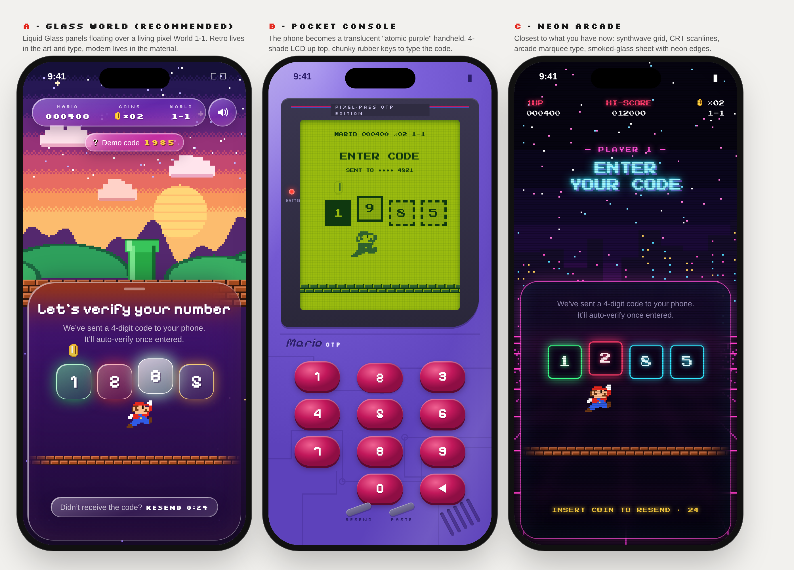

# Saved UI directions

Three retro × modern directions explored for the verify screen (not in the app yet):

- **A · Glass World**: Liquid Glass panels over a pixel World 1-1 at dusk.
- **B · Pocket Console**: the screen as a translucent purple handheld with an LCD and rubber keys.
- **C · Neon Arcade**: synthwave grid, CRT scanlines, smoked glass with neon edges.

`concepts.html` is the source of the mockup: open it in a browser. The fonts in `assets/` (Pixelify Sans,
Silkscreen, Press Start 2P) are SIL Open Font License fonts from Google Fonts.
